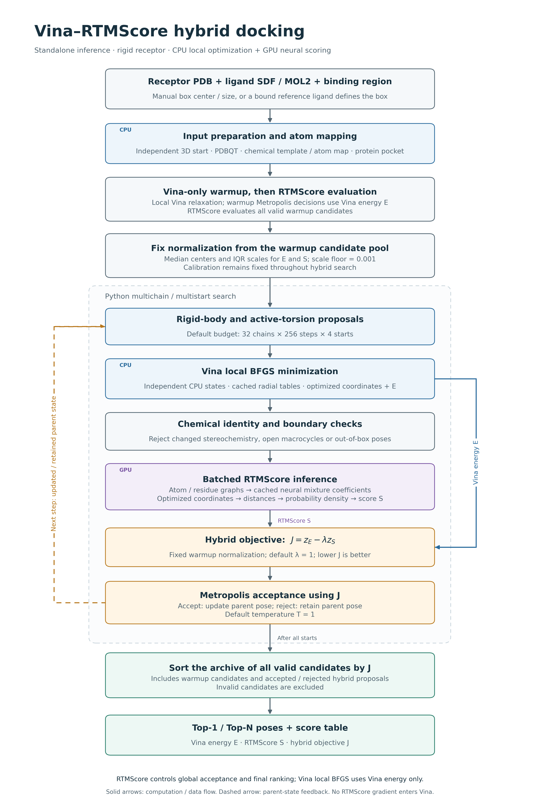
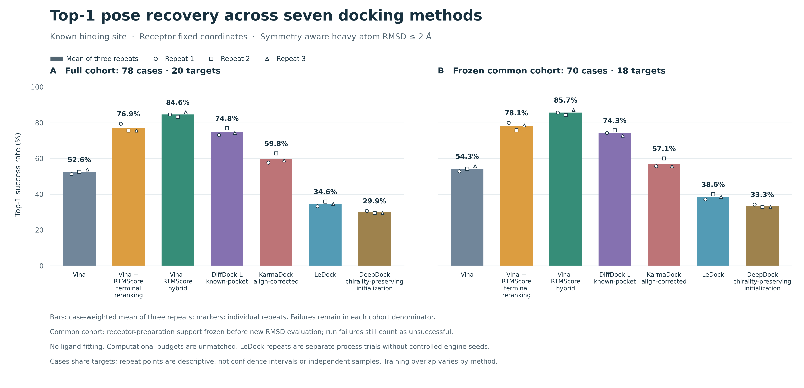

# Vina–RTMScore Hybrid Docking

An inference-only distribution for docking **a new small molecule into a new protein structure**. The method combines Python-controlled global pose exploration, Vina local minimization on the CPU, and RTMScore scoring on the GPU.

The hybrid objective controls both search-state acceptance and final pose selection. This folder contains the required inference code, the RTMScore model1 checkpoint, an isolated Vina native library and its rebuild sources. Historical docking datasets, benchmark runners, other docking engines, old experiment outputs and Python environments are excluded.

## Contents

- [Quick start](#quick-start)
- [Runtime setup](#runtime-setup)
- [Supported inputs](#supported-inputs)
- [How the hybrid method works](#how-the-hybrid-method-works)
- [Command-line options](#command-line-options)
- [Outputs](#outputs)
- [Multiple molecules and seeds](#multiple-molecules-and-seeds)
- [Benchmark figure](#benchmark-figure)
- [Validation and limitations](#validation-and-limitations)
- [Folder layout](#folder-layout)

## Quick start

Run commands from this directory after configuring the environments described below. All example paths and box coordinates must be replaced with your actual inputs. Each output directory must **not already exist**.

### Manual docking box

```bash
./dock.sh \
  --receptor /path/to/protein.pdb \
  --ligand /path/to/new_ligand.sdf \
  --center 10 20 30 \
  --size 22 22 22 \
  --out /path/to/results/manual_run
```

Coordinates are in the input protein frame and all distances are in angstroms. `--size` gives the **full side lengths**, not radii or half-widths.

### Box from a bound reference ligand

```bash
./dock.sh \
  --receptor /path/to/protein.pdb \
  --ligand /path/to/new_ligand.mol2 \
  --reference-ligand /path/to/bound_ligand.sdf \
  --padding 6 \
  --out /path/to/results/reference_run
```

The molecule specified by `--ligand` is the molecule being predicted. The reference ligand is used only to locate the docking region and crop the protein pocket; it can be a different molecule. It must already have 3D coordinates in the **same coordinate frame as the protein**. There is no automatic receptor alignment.

The box is the heavy-atom bounding box of the reference ligand, extended by `padding` on each side:

```text
center = (minimum_coordinates + maximum_coordinates) / 2
size   = maximum_coordinates - minimum_coordinates + 2 * padding
```

Manual-box and reference-ligand modes are mutually exclusive. Reference files may be single-molecule SDF or MOL2 files.

### Preparation only

Add `--prepare-only` to either complete command to validate and prepare the inputs without searching. Inspect `prepared/` and `preparation.json`. The final status is `prepared`; perform a subsequent docking run with the original inputs and a **new output directory**.

### Small installation check

Add the following options to a complete docking command:

```bash
--chains 4 --warmup 2 --steps 8 --restarts 2 --relax-workers 2
```

This runs 64 global proposals plus warmup and initialization. These settings check the interface and environment; use the default budget for a full search.

## Runtime setup

### Required environments

The launcher selects `VINA_RTMSCORE_PYTHON`, then `.venv/bin/python` if present, and otherwise `python3` from `PATH`. The search/preparation interpreter needs Python, NumPy, SciPy, RDKit, Gemmi and Meeko. Open Babel must be available as an executable.

```bash
python3 -m venv .venv
. .venv/bin/activate
python -m pip install -r requirements-search.txt
```

`requirements-search.txt` is a dependency list, not a full environment lock. The versions actually used for validation are recorded in [environment/tested_runtime.json](environment/tested_runtime.json).

The RTMScore worker additionally needs a working CUDA installation and compatible PyTorch, DGL, torch-scatter, MDAnalysis, pandas, joblib, scikit-learn, ProDy and RDKit installations. It may use a separate interpreter. The tested worker used Python 3.9, PyTorch 1.12.1, DGL 1.1.1+cu113 and CUDA 11.3. Install mutually compatible builds for your hardware; the search dependency list alone does not install the GPU worker environment.

```bash
export VINA_RTMSCORE_PYTHON=/path/to/search_env/bin/python
export RTMSCORE_PYTHON=/path/to/rtm_env/bin/python
export VINA_RTMSCORE_OBABEL=/path/to/obabel
```

If `RTMSCORE_PYTHON` is unset, the worker uses the search interpreter, which must then satisfy both dependency sets. Open Babel is discovered from `VINA_RTMSCORE_OBABEL` or `PATH`. Interpreter and executable defaults contain no dependency on the original project directory.

On the original server, the existing environments can be reused without copying the old scientific code:

```bash
export VINA_RTMSCORE_PYTHON=/home/mol/vina-rtmscore/.venv-search/bin/python
export RTMSCORE_PYTHON=/home/mol/miniconda3/envs/karmadock/bin/python
export VINA_RTMSCORE_OBABEL=/home/mol/miniconda3/envs/karmadock/bin/obabel
```

These paths are optional server-specific examples. The exported code, model and native-library paths are resolved within **this folder**. No Python/conda environment is bundled.

### Native Vina library

`native/libfast_vina.so` is a prebuilt Linux library validated on the original server. It requires compatible system/C++ and Boost shared libraries; it is not a cross-platform binary. See [native dependency information](environment/native_ldd.txt).

To rebuild on another compatible Linux system, install a C++ compiler and Boost development libraries, then run:

```bash
python scripts/build_fast_vina.py --boost-prefix /path/to/boost/prefix --jobs 2
```

The Boost prefix must contain `include/boost` and the required shared libraries under `lib`. The builder uses the bundled, SHA-verified Vina 1.2.7 source archive and does not download source. It creates a private build directory and adds the existing adapter's friend declaration; Vina scoring and optimization mathematics are preserved. Rebuilding changes the native-library provenance, so revalidate the new build before production use.

An alternate compatible library can be selected with `FAST_VINA_LIBRARY`. The actual loaded library is hashed in each run record.

### Model checkpoint

The default checkpoint is bundled at:

```text
third_party/RTMScore/trained_models/rtmscore_model1.pth
```

Its SHA256 is `399727a85de96c011a75a4c242ebe947753724f01e8d15139fae7bcad106bfc2`. The official inference modules and license are included. A package marker and worker path check ensure that an unrelated installed RTMScore cannot override the bundled source. Only model1 is distributed; `--model` selects a PDB model, not a neural checkpoint.

## Supported inputs

### Protein

- Supply a protein `.pdb` file. The receptor is rigid during docking.
- Standard protein residues must contain their expected heavy atoms. Missing residues, loops and missing side-chain atoms are not automatically rebuilt.
- A multi-model PDB requires an explicit one-based `--model` index. Use `--receptor-chains A B` to select protein chains.
- Alternate locations are selected consistently using residue occupancy, and retained heavy-atom coordinates are checked after receptor conversion.
- Waters are removed automatically. Unclassified nonprotein residues require explicit removal by name, such as `--remove-residues LIG`, after confirming that they are free ligands that should be removed.
- Recognized metals, cofactors, modified residues and recorded covalent connections crossing a retained/removed boundary are rejected rather than silently deleted. Chain selection cannot silently cut a recorded disulfide bond.
- Receptor preparation uses Open Babel rigid PDBQT conversion, pH 7.4 treatment and Gasteiger charges. Review protonation and biological composition for your structure.

### Ligand

- Supply exactly one molecule in SDF or MOL2. Multi-record files and disconnected fragments/salts are rejected.
- A 2D SDF is supported. Input ligand coordinates are discarded before independent ETKDGv3 embedding and MMFF/UFF optimization.
- Bond orders, formal charges, supported heavy-atom isotopes and specified stereochemistry are retained. Protonation states, tautomers and stereoisomers are not automatically enumerated.
- Supported heavy elements are C, N, O, F, P, S, Cl, Br and I. Radicals, retained explicit isotopic/stereo-defining hydrogens, unsupported elements and unresolved/unknown/relative/racemic stereochemistry are rejected.
- Meeko supplies an explicit heavy-atom map. Predicted coordinates are restored onto the original chemical graph rather than inferring bond orders from PDBQT.
- Template SDF normalization accounts for harmless MOL2 bond-endpoint ordering differences while verifying that atom order, chemical identity and stereochemistry are unchanged.

Reference-ligand coordinates must be finite, noncollapsed 3D coordinates in the receptor frame. Arbitrarily embedding a reference ligand does not determine a binding site.

### Pocket selection

For a manual box, RTMScore receives whole protein residues within 10 Å of the entire box. For a reference-defined box, it receives whole residues within 10 Å of the reference ligand's heavy atoms. These are different pocket definitions and can produce different scores even with the same box. The actual strategy and residue list are saved in `preparation.json`.

## How the hybrid method works



1. Prepare the receptor, independent ligand start, atom map and protein pocket.
2. Run Vina-energy-driven warmup and score its valid candidates with RTMScore.
3. Estimate and freeze the median/IQR normalization parameters.
4. Explore rigid-body and active-torsion proposals across multiple chains and starts.
5. Locally optimize each valid proposal using Vina on the CPU, then check chemistry, stereochemistry, boundaries and macrocycle closure.
6. Score optimized coordinates with GPU RTMScore and use the hybrid objective for Metropolis acceptance.
7. Rank all valid candidates, including warmup and rejected proposals, by the hybrid objective.

```text
zE = (E - median(E)) / max(IQR(E), 0.001)
zS = (S - median(S)) / max(IQR(S), 0.001)
J  = zE - weight * zS
```

Here `E` is Vina energy, `S` is RTMScore, and **lower J is better**. Normalization is fitted to warmup candidates and then fixed. The default weight and temperature are both 1.

The default budget is 32 chains × 256 steps × 4 starts = 32,768 global proposals, with 128 additional warmup proposals and separately capped initialization attempts. Invalid proposals consume budget; rejected moves retain their parent state.

Vina local optimization runs on the CPU, using independent worker states and coordinate-independent radial-table caching. RTMScore caches fixed chemical-graph neural coefficients and recomputes coordinate distances and probability densities on the GPU. RTMScore influences global acceptance and final ranking; it does not provide gradients to the Vina local optimizer. Macrocycle handling uses conservative closure checks rather than reproducing the full native Vina macrocycle search.

## Command-line options

```bash
./dock.sh --help
```

| Option | Default | Meaning |
|---|---|---|
| `--receptor` | required | Protein PDB file |
| `--ligand` | required | One molecule in SDF/MOL2 |
| `--out` | required | New, nonexistent output directory |
| `--center X Y Z` | one region mode required | Manual box center, Å |
| `--size SX SY SZ` | required with center | Full box side lengths, Å |
| `--reference-ligand` | alternative region mode | Bound reference SDF/MOL2 |
| `--padding` | 6 | Reference-box padding per side, Å |
| `--receptor-chains A B` | all supplied protein chains | Protein chain IDs |
| `--model` | 1 for single-model files | One-based PDB model index |
| `--remove-residues LIG ...` | none | Explicitly removable free nonprotein residue names |
| `--seed` | 20261021 | Integer from 1 to 2147483647 |
| `--chains` | 32 | Search-chain count; not protein-chain selection |
| `--warmup` | 4 | Warmup steps per search chain |
| `--steps` | 256 | Hybrid steps per chain per start |
| `--restarts` | 4 | Number of starts |
| `--local-steps` | 300 | Maximum Vina local-optimization steps |
| `--relax-workers` | 8 | CPU local-optimization workers per task |
| `--num-poses` | 20 | Maximum poses written to poses.sdf |
| `--weight` | 1 | Nonnegative RTMScore weight in J |
| `--temperature` | 1 | Positive hybrid acceptance temperature |
| `--translation` | 2 | Translation scale, Å; also scales rotations |
| `--prepare-only` | off | Prepare/check inputs without pose search |
| `--rtm-python` | environment variable or search interpreter | GPU worker interpreter |
| `--obabel` | environment variable or PATH discovery | Open Babel executable |

Budget/worker/count options must be positive integers. Float parameters must be finite; box lengths, padding, temperature and translation must be positive. `--root` and `--rtm-root` are internal path overrides. There is no legacy PDB-ID, dataset, benchmark-evaluation or multi-engine interface in this export.

Increasing `--num-poses` changes saved output count, not search effort. Increasing chains/steps/starts increases exploration. More local workers may improve throughput but also increase CPU and memory use.

## Outputs

| File | Contents |
|---|---|
| `selected.sdf` | The top-ranked hybrid pose |
| `poses.sdf` | Up to N ranked candidates; no clustering/deduplication |
| `scores.csv` | All valid candidates ranked by J |
| `evaluated.sdf.gz` | All valid candidate structures |
| `run.json` | Status, configuration, source/model/output hashes, verification |
| `preparation.json` | Input hashes, box, pocket, receptor processing, atom map |
| `inputs/` | Original input copies |
| `prepared/` | Processed receptor, ligand template/start, PDBQT, pocket and logs |
| `trace.jsonl.gz` | Search-state and acceptance trace |
| `evaluations.jsonl.gz` | Optimized-coordinate and score journal |
| `progress.json` | Current phase/step and elapsed time |
| `rtm_worker.log` | Worker diagnostics |
| `error.log` | Detailed failure trace when a run fails |

The score table contains `rank`, `pose_id`, `vina_energy`, `rtmscore`, `hybrid_objective`, `origin`, `chain`, `restart` and `step`. SDF properties identify the matching candidate and scores.

Lower Vina energy, higher RTMScore and lower J are preferred. These search scores are not measured binding affinities. Different tasks have different normalization parameters, so J should not be used directly for cross-ligand affinity ranking. Similar high-ranking poses may occupy the same basin because outputs are not clustered.

`run.json` states are `running`, `prepared`, `completed` or `failed`. Failures return a nonzero exit code and preserve diagnostics. Existing directories, including empty ones, are never silently overwritten; use a new directory for another attempt.

## Multiple molecules and seeds

One invocation processes one molecule and one seed. For separate single-molecule SDF files:

```bash
mkdir -p runs/library
for ligand in /path/to/ligands/*.sdf; do
  [ -f "$ligand" ] || continue
  name="$(basename "$ligand" .sdf)"
  ./dock.sh --receptor /path/to/protein.pdb --ligand "$ligand" \
    --center 10 20 30 --size 22 22 22 \
    --out "runs/library/$name" || break
done
```

Create only the shared parent directory. Each task output directory must remain nonexistent until its invocation. Use distinct directories for different seeds, and budget CPU/GPU resources before running concurrent tasks.

## Benchmark figure



This figure is an English rendering of the existing frozen evaluation, not a new experiment. The primary cohort contains 78 complexes across 20 targets, with three repeated runs. Success is receptor-frame, symmetry-aware heavy-atom RMSD ≤ 2 Å, without independent ligand fitting. Failed runs remain in the denominator. The second panel is the predefined common preprocessing subset: 70 complexes, 18 targets.

| Method | Full-cohort mean Top-1 |
|---|---:|
| Vina | 52.56% |
| Vina + RTMScore terminal reranking | 76.92% |
| Vina–RTMScore hybrid search | 84.62% |
| DiffDock-L, known-pocket setup | 74.79% |
| KarmaDock, align-corrected | 59.83% |
| LeDock | 34.62% |
| DeepDock, chirality-preserving initialization | 29.91% |

The repeats are repeated measurements, not independent new complexes. LeDock does not expose controlled engine seeds. LeDock and DeepDock each have eight preprocessing-unsupported cases; LeDock has additional runtime failures, all retained in the primary denominator. DeepDock denotes the explicitly documented chirality-preserving initialization compatibility variant. Methods differ in budgets, candidates, feature regions and postprocessing, and training overlap is known or unknown; this is not an equal-cost or strict unseen-target comparison.

Only the figure statistics/provenance are included in [figures/figure_data.json](figures/figure_data.json). The benchmark dataset and the seven engines' execution code are not included.

## Validation and limitations

The export preserves the original hybrid engine, geometry operations, cache arithmetic and native adapter. Packaging changes are limited to the module namespace, dependency extraction, package-local asset paths, runtime defaults and source-provenance collection. Original file/function origins are recorded in [export_origins.json](export_origins.json).

The GPU scorer compares its initial cached predictions with the official RTMScore graph path and public scoring API using `atol=rtol=1e-6`. Each run stores the evidence and hashes its checkpoint and inference sources. Source/input/model changes during a run cause a failure rather than accepting an untracked result.

Export-specific test results are summarized in [validation.json](validation.json). The isolated validation uses a 2D new ligand with a manual box and a MOL2 new ligand with a different bound reference ligand, plus chemistry/input/output regression tests. These checks establish engineering and numerical consistency, not prospective accuracy for a new target.

The current method requires a known region and CUDA scoring. It does not predict binding sites, model protein flexibility, support general covalent/metal docking, enumerate ligand chemical states, or compute RMSD/success rates without a true reference pose. Chemistry/finite-coordinate checks are not a complete physical-validity certification.

## Folder layout

```text
vina-rtmscore/
  README.md                    English usage and method documentation
  dock.sh                      New protein/ligand docking launcher
  requirements-search.txt      Search/preparation dependency list
  vina_rtmscore/               Inference-only Python modules
  scripts/
    dock.py                    File-based CLI
    rtm_worker.py              Cached CUDA scoring worker
    build_fast_vina.py         Offline native-library builder
  native/                      Vina adapter, binary, source archive, provenance/license
  third_party/RTMScore/         Required official inference modules and model1
  figures/                     English benchmark and hybrid architecture figures
  environment/                 Tested versions and native dependency references
  export_origins.json          Source extraction/copy provenance
  validation.json              Export verification summary
  MANIFEST.sha256              Checksums of packaged files
  NOTICE.md                    Third-party source/license notes
```

For errors, inspect `run.json`, `error.log`, the preparation log and `rtm_worker.log`. Check coordinate frames when the pocket is empty, enlarge or reposition a box that cannot contain the ligand, resolve explicitly reported chemical components, and verify interpreter/CUDA/Boost compatibility when workers or the native library cannot load.

Keep the bundled third-party licenses and provenance when redistributing this directory. The original native build record describes its original build location; those historical paths are not runtime imports or required project data paths.
